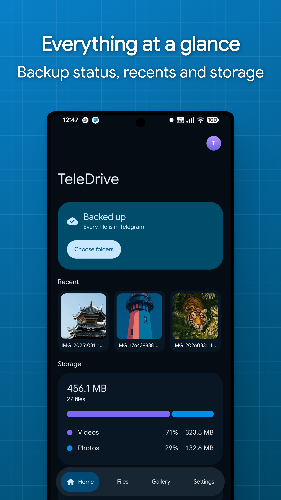
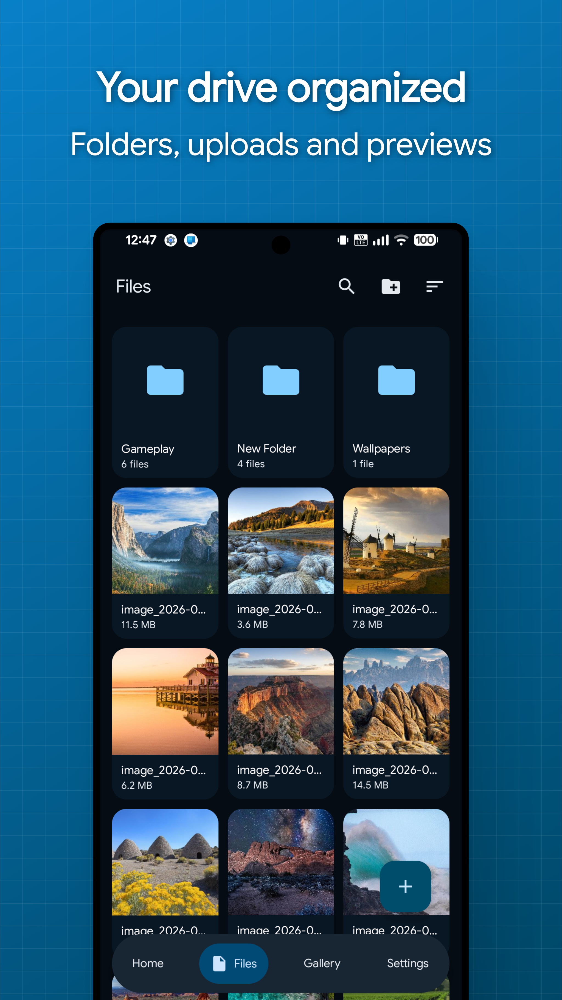
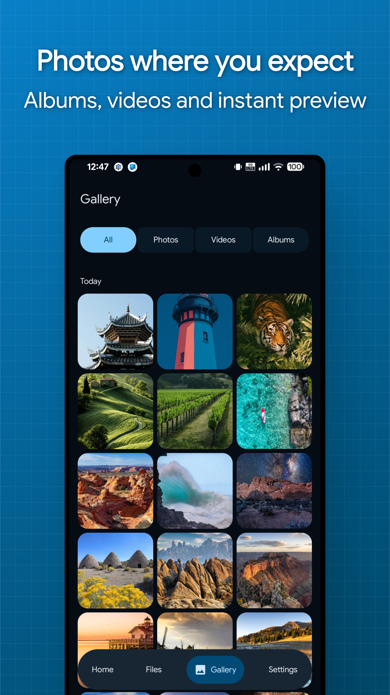
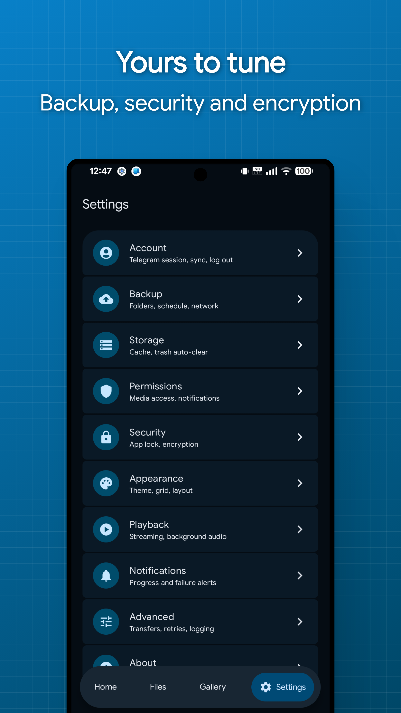

<p align="right">Português · <a href="README.es.md">Español</a></p>

<div align="center">


# RamonDrive

Faça backup e navegue pelos seus arquivos usando um canal privado do Telegram como armazenamento.

[](#requisitos)
[](#requisitos)
[](#requisitos)
[](#requisitos)
[](https://kotlinlang.org)
[](https://www.jetbrains.com/compose-multiplatform/)
[](https://github.com/RamonMods/RamonDrive/releases/latest)
[](https://github.com/RamonMods/RamonDrive/releases)
[](LICENSE)
<br><br>
<a href="https://pixgg.com/ramon"></a>
</div>

---

## Conteúdo

- [Sobre](#sobre) · [Recursos](#recursos) · [Capturas de tela](#capturas-de-tela)
- **Instalação**: [Windows](#windows) · [Linux (x86_64)](#linux-x86_64) · [macOS (Apple Silicon)](#macos-apple-silicon) · [Android](#android)
- [Requisitos](#requisitos) · [Primeiros passos](#primeiros-passos) · [Empacotando o app de desktop](#empacotando-o-app-de-desktop)
- [Trazendo arquivos existentes](#trazendo-arquivos-existentes) · [Bom saber](#bom-saber)
- [Arquitetura](#arquitetura) · [Modelo de segurança](#modelo-de-segurança) · [Testes](#testes)
- [Contribuindo](#contribuindo) · [Licença](#licença)

---

## Sobre

O RamonDrive guarda seus arquivos em um canal privado do Telegram na sua própria
conta. Não existe servidor do RamonDrive nem conta para criar com a gente. O app
mantém um índice local para que a navegação e a busca continuem rápidas e
funcionem offline.

Uma única base de código Compose Multiplatform entrega o app Android e os apps de
desktop para Windows, Linux x86_64 e macOS. Eles compartilham o mecanismo de
armazenamento, a criptografia, as transferências e toda a camada de interface, e
todos navegam pelo mesmo drive.

## Recursos

- **Backup automático**: fotos e pastas escolhidas são enviadas sozinhas no Android, com agendamentos, regras de Wi-Fi e carregamento, e padrões de exclusão
- **Sem limite de tamanho de arquivo**: um vídeo de 20 GB é um único arquivo no app, qualquer que seja o limite de mensagem do Telegram
- **Criptografia**: AES-256-GCM opcional para o conteúdo dos arquivos, nomes, legendas e árvore de pastas
- **Gerenciamento de arquivos**: pastas, favoritos, itens ocultos e arquivados, lixeira e ações em massa
- **Streaming**: vídeo e áudio tocam direto do Telegram com busca (seek), inclusive arquivos criptografados
- **Prévias**: imagens, PDFs, texto e conteúdo de ZIP abrem na hora
- **Múltiplos drives**: canais separados para pessoal, trabalho ou fotos em uma mesma conta
- **Compartilhamento**: arquivos chegam pela folha de compartilhamento do Android, e bytes idênticos nunca são enviados duas vezes
- **Transferências**: fila paralela com pausa e retomada que sobrevive a reinicializações
- **Recuperação**: reinstale, entre na conta, digite sua passphrase e o drive inteiro volta
- **Segurança do dispositivo**: bloqueio por biometria, bloqueio de capturas de tela e cache local criptografado

## Capturas de tela

<div align="center">
   
</div>

## Instalação

### Windows

Baixe `RamonDrive-<version>.msi` na [página de releases](../../releases) e
execute. Ele instala por usuário, sem pedir administrador, adiciona atalhos no
menu Iniciar e na área de trabalho, e é desinstalado pelas Configurações do
Windows. Sua sessão e suas configurações ficam em `%APPDATA%\RamonDrive` e
sobrevivem a reinstalações.

### Linux (x86_64)

Baixe na [página de releases](../../releases). Tudo está incluído, então não há
nada mais para instalar.

**AppImage** (a maioria das distros de 2022 em diante)

1. Baixe `RamonDrive-<version>-x86_64.AppImage`.
2. Torne-o executável: clique com o botão direito → **Propriedades** → **Permitir
   executar o arquivo como programa**, ou `chmod +x RamonDrive-<version>-x86_64.AppImage`.
3. Dê um duplo clique nele.

**.deb** (Ubuntu 24.04, Debian 13 ou mais recente)

```bash
sudo apt install ./ramondrive_<version>_amd64.deb
```

Depois abra o RamonDrive no menu de aplicativos.

### macOS (Apple Silicon)

Baixe `RamonDrive-<version>.dmg` na [página de releases](../../releases), abra e
arraste o RamonDrive para Aplicativos. A build é apenas para Apple Silicon, porque
a biblioteca nativa do Telegram que o RamonDrive usa não tem build para Mac Intel.

O app não é assinado com um Apple Developer ID, então o Gatekeeper o bloqueia na
primeira execução. Limpe a marca de quarentena uma vez e ele abrirá normalmente
a partir de então:

```bash
xattr -dr com.apple.quarantine /Applications/RamonDrive.app
```

Sua sessão e suas configurações ficam em `~/Library/Application Support/RamonDrive`.

A prévia de mídia funciona de imediato. Como na build para Windows, o app traz
sua própria cópia do libVLC, então não há mais nada para instalar. Se por acaso
ele falhar ao carregar, um VLC em `/Applications` é usado em vez dele e, se isso
também falhar, o app ainda abre, navega, envia e baixa, com a prévia caindo para
abrir o arquivo no aplicativo padrão.

### Android

Pegue um APK na [página de releases](../../releases). As builds são divididas por
arquitetura de CPU, então escolha a que combina com seu aparelho:

| APK | Use quando |
| --- | --- |
| `RamonDrive-<version>-arm64-v8a-release.apk` | Quase todo celular dos últimos anos |
| `RamonDrive-<version>-armeabi-v7a-release.apk` | Aparelhos 32 bits mais antigos |
| `RamonDrive-<version>-x86_64-release.apk` | Emuladores 64 bits e Chromebooks x86 |
| `RamonDrive-<version>-x86-release.apk` | x86 32 bits, raro fora de emuladores antigos |
| `RamonDrive-<version>-universal-release.apk` | Você não tem certeza, ou vai instalar em algo incomum |

A universal carrega todas as arquiteturas de uma vez, então prefira uma build
específica a menos que precise do fallback. A maior parte desse tamanho é o
TDLib, a biblioteca oficial do Telegram na qual o app é construído.

## Requisitos

- Android 8.0 (API 26) ou mais recente, Windows 10+ 64 bits, Linux x86_64, ou macOS em Apple Silicon
- Uma conta do Telegram
- Suas próprias credenciais da API do Telegram, gratuitas em
  [my.telegram.org](https://my.telegram.org) em *API development tools*

Para obter as credenciais: entre em [my.telegram.org](https://my.telegram.org), abra
*API development tools* e preencha um nome e um nome curto para o app. Qualquer
coisa razoável serve, e a plataforma e a descrição não importam. A página então
mostra um **api_id** e um **api_hash**, que é o que o RamonDrive pede no primeiro
uso.

Você informa o API ID e o hash em tempo de execução e eles ficam armazenados
criptografados no dispositivo. Nunca são incluídos no app, escritos em logs ou
enviados a qualquer lugar que não seja o Telegram. Como são seus e não
compartilhados, seu uso nunca é somado ao de outra pessoa, e um limite de
requisições de outra pessoa não pode afetar você.

## Primeiros passos

```bash
git clone https://github.com/RamonMods/RamonDrive.git
cd RamonDrive
./gradlew :android:installDebug  # Android
./gradlew :desktop:run           # Desktop Windows/Linux
```

Depois, no app:

1. Informe seu API ID e hash.
2. Entre com número de telefone e código de login, ou escolhendo **Entrar com
   código QR**. Se o Telegram estiver instalado no mesmo dispositivo, a etapa do
   QR oferece um botão **Confirmar no Telegram**, então não é preciso escanear nada.
3. Escolha as pastas para backup.
4. Opcionalmente ative **Criptografar uploads** e defina uma passphrase de recuperação.

As bibliotecas nativas do TDLib vêm pré-compiladas em todas as plataformas: o AAR
do [`tdlibx/td`](https://github.com/tdlibx/td) via JitPack no Android e
[tdlight](https://github.com/tdlight-team/tdlight-java) no desktop (Windows,
Linux e macOS Apple Silicon), então nenhum toolchain nativo é necessário. A build
escolhe a nativa correspondente ao host, então um pacote nunca carrega um conjunto
não utilizado.

### Empacotando o app de desktop

O jpackage faz o empacotamento, e o runtime do Android Studio não o inclui. Aponte
a build para um JDK completo com a propriedade `desktopJavaHome` no seu
`~/.gradle/gradle.properties` global, e então:

```bash
./gradlew :desktop:packageMsi           # Instalador Windows
./gradlew :desktop:packageDebUser       # .deb do Linux com dependências do sistema
./gradlew :desktop:packageAppImage      # AppImage do Linux para qualquer distro
./gradlew :desktop:packageDmg           # Imagem de disco do macOS
./gradlew :desktop:createDistributable  # Pasta do app portátil
```

`packageDebUser` produz `desktop/build/deb/ramondrive_<version>_amd64.deb`. Ele
embute um runtime da JVM via jlink e declara suas dependências Debian, então os
usuários finais só precisam de `sudo apt install ./ramondrive_<version>_amd64.deb`.
O libVLC não é embutido no Linux, ele é trazido como dependência de pacote.

`packageAppImage` produz
`desktop/build/appimage/RamonDrive-<version>-x86_64.AppImage` a partir da mesma
pasta do app e embute o libVLC instalado na máquina de build junto com as
bibliotecas de que seus plugins precisam. Ele executa
[`desktop/packaging/linux/build-appimage.sh`](desktop/packaging/linux/build-appimage.sh),
que precisa de `patchelf`, `desktop-file-utils`, os pacotes `libvlc5`,
`libvlccore9`, `vlc-plugin-base` e `vlc-plugin-video-output`,
[linuxdeploy](https://github.com/linuxdeploy/linuxdeploy) e
[appimagetool](https://github.com/AppImage/appimagetool). Coloque os dois últimos
no `PATH`, ou passe `-Plinuxdeploy=/caminho/para/linuxdeploy` e
`-Pappimagetool=/caminho/para/appimagetool`. Compile na distro mais antiga que
você quer suportar, já que as bibliotecas embutidas definem a glibc mínima; as
builds de release usam Ubuntu 22.04.

## Trazendo arquivos existentes

Já tem arquivos em um canal, grupo ou Mensagens Salvas? Encaminhe-os para o drive
que o RamonDrive criou e eles aparecem no app após a próxima sincronização. O
encaminhamento acontece nos servidores do Telegram, então nada é baixado ou
enviado de novo, e arquivos de qualquer tamanho atravessam em segundos.

Selecione as mensagens no app do Telegram, encaminhe-as para o seu canal do
RamonDrive e puxe para atualizar no RamonDrive.

O que esperar de arquivos encaminhados:

- Só mensagens enviadas **como documentos** são reconhecidas. Uma foto ou vídeo
  enviado da forma normal foi comprimido pelo Telegram em uma mensagem de mídia, e
  essas são ignoradas. Encaminhe a versão original do arquivo.
- **As legendas são substituídas.** O RamonDrive guarda o nome, a pasta e os
  marcadores de cada arquivo na legenda, então a primeira renomeação, movimentação
  ou envio para a lixeira sobrescreve o texto que a mensagem tinha.
- **Nenhum checksum é registrado**, já que o arquivo nunca é lido localmente. A
  detecção de duplicados não consegue casar arquivos encaminhados, então enviar o
  mesmo arquivo depois cria uma segunda cópia.
- Os arquivos chegam na raiz do drive e permanecem sem criptografia, porque já
  estavam armazenados assim. Depois mova-os para pastas no app.

## Arquitetura

Kotlin Multiplatform com Clean Architecture e MVVM. A regra de dependência é
`presentation -> domain <- data`, com `core` compartilhado pelos dois lados.
Nenhum tipo do TDLib sai de `core/telegram`. Quase tudo vive em código comum; cada
plataforma contribui apenas com o que a outra não pode compartilhar, como workers,
o Keystore, o DPAPI ou o armazenamento de chaves em arquivo do desktop, e as
cascas dos apps.

```text
shared/               # KMP: mecanismo de armazenamento, cripto, sync, transferências
├── commonMain/           # core, data, domain
├── jvmCommonMain/        # partes JVM que os dois apps usam
├── androidMain/          # cola de Keystore, MediaStore e WorkManager
└── desktopMain/          # cliente tdlight, cifras de plataforma, agendadores
ui/                   # KMP: todas as telas, tema e recursos de string
├── commonMain/           # recursos do compose
└── jvmCommonMain/        # toda a camada de apresentação
android/              # casca Android: workers, notificações, player media3
desktop/              # casca Windows/Linux: janela, empacotamento, ponte de streaming
```

Stack: Kotlin Multiplatform, Coroutines, Compose Multiplatform, Material 3
Expressive, Koin, Room KMP, DataStore, WorkManager, Paging 3, Media3, Coil,
TDLib e tdlight.

## Modelo de segurança

| Camada | O que é protegido |
| --- | --- |
| No dispositivo | Bancos do Room e do TDLib selados com uma chave aleatória embrulhada pela plataforma (Android Keystore, Windows DPAPI ou uma chave em arquivo local no Linux). Miniaturas e caches são criptografados com AES-GCM por padrão. |
| No Telegram | Com a criptografia ligada, o canal guarda apenas bytes selados, nomes de arquivo aleatórios, legendas criptografadas e uma árvore de pastas criptografada. |
| Custódia das chaves | As chaves de conteúdo são aleatórias, embrulhadas pela chave mestra da plataforma e nunca saem do dispositivo desembrulhadas. |
| Recuperação | A chave de conteúdo é copiada para o seu canal, selada com a sua passphrase (PBKDF2, 310 mil iterações). Restaurá-la em um novo dispositivo destrava tudo. |

Alguém que leia o canal sem a sua chave descobre apenas a quantidade de arquivos,
os tamanhos e os horários. A passphrase não tem caminho de redefinição, e isso é
proposital, então defina uma dica ao criá-la e mantenha a passphrase fora da dica.

## Bom saber

- Um arquivo acima do limite por arquivo do Telegram é guardado como várias
  mensagens, então abri-lo no app do Telegram mostra as partes em vez do arquivo
  inteiro. Só o RamonDrive o monta de volta.
- O streaming autentica os quadros que reproduz, não o arquivo inteiro. O download
  verifica tudo, então use-o quando a integridade importar mais do que começar rápido.
- O Telegram não consegue renomear um documento dentro de uma mensagem já enviada,
  então uma renomeação atualiza o manifesto da legenda, que é o que uma
  reconstrução lê.
- O TDLib não consegue retomar um único upload, então pausar um que caiba em uma
  mensagem o reinicia. Um upload dividido retoma na última parte concluída, e os
  downloads sempre retomam.

## Testes

```bash
./gradlew testDebugUnitTest          # Testes unitários cobrindo cripto, backup de chaves,
                                     # construção de consultas, decisões de backup, nomes
./gradlew connectedDebugAndroidTest  # Comportamento do DAO do Room em um dispositivo
./gradlew :desktop:test              # Grafo de DI do desktop e costuras de plataforma
```

## Contribuindo

Issues e pull requests são bem-vindos. Mantenha a regra de dependência intacta,
siga o estilo do código ao redor e adicione testes para mudanças nos pacotes de
domínio ou criptografia de `shared/`.

## Licença

[Apache License 2.0](LICENSE).

TDLib é BSL-1.0. O wrapper Android pré-compilado (`tdlibx/td`) é Apache-2.0.

---

<div align="center">
<sub>RamonDrive é um projeto independente, não afiliado nem endossado pelo Telegram.</sub>
</div>
